# Lexa Store — Oyun Mağazası ve OTP (Guard) Kod Yönetim Sistemi

Paylaşımlı oyun ve servis hesabı satan mağazalar için uçtan uca bir platform: müşteri, pazaryerinden (İtemSatış vb.) aldığı **1–5 oyunluk seçim anahtarını** sitede doğrular, katalogdan oyunlarını seçer, hesap bilgilerine kütüphanesinden ulaşır ve platformun giriş sırasında istediği **doğrulama kodunu (Steam Guard, EA, Epic, Ubisoft, Rockstar, Microsoft, ChatGPT…) tek tıkla, canlı olarak** alır.

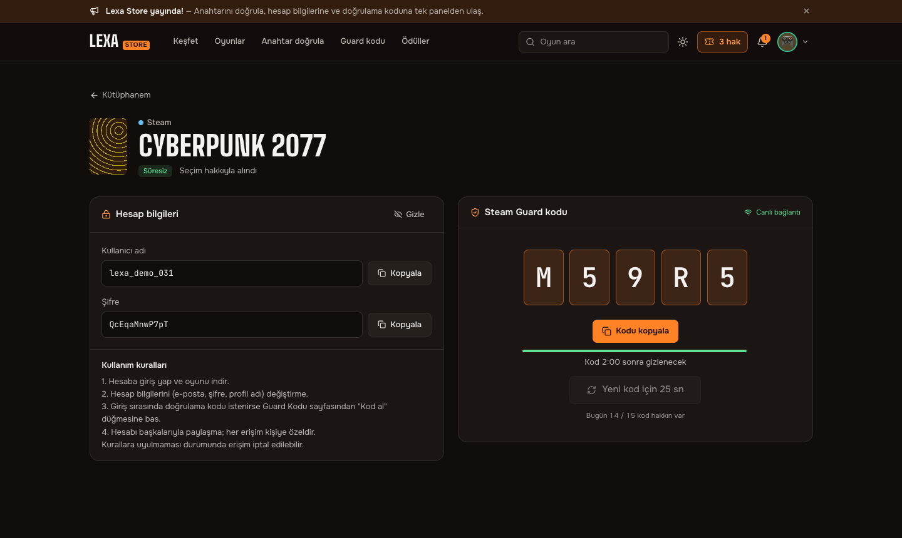

> Bu depo sistemin **tanıtımıdır**: nasıl çalıştığını mimari görselleri ve ekran görüntüleriyle anlatır. Kaynak kodu özel bir depoda tutulur.

## İçindekiler

- [Ne yapar?](#ne-yapar)
- [Sistem nasıl çalışır?](#sistem-nasıl-çalışır) — sekiz görselle
- [Özellikler](#özellikler)
- [Ekran görüntüleri](#ekran-görüntüleri)
- [Doğrulama kodu kaynakları](#doğrulama-kodu-kaynakları)
- [Güvenlik](#güvenlik)
- [Testler](#testler)
- [Bilinen sınırlar ve yol haritası](#bilinen-sınırlar-ve-yol-haritası)

## Ne yapar?

Hesap satan bir mağazanın en çok zaman kaybettiği iş, müşteriye **giriş kodunu yetiştirmektir**: müşteri hesaba girer, platform e-postaya kod yollar, müşteri satıcıya yazar, satıcı kodu bulup iletir. Lexa Store bu döngüyü otomatikleştirir:

1. Müşteri pazaryerinden bir **seçim anahtarı** satın alır: 1, 2, 3, 4 ya da 5 oyunluk. Sen ona anahtarı teslim edersin.
2. Müşteri anahtarı sitede doğrular ve anahtar kaç oyunluksa katalogdan **o kadar oyun seçer**. Seçtiği oyunlar hesabında kalır; haklarının hepsini aynı anda kullanmak zorunda değildir.
3. Sistem her oyun için hesap havuzundan boş bir slot ayırır; müşteri kullanıcı adı ve şifreyi kütüphanesinden kopyalar.
4. Platform kod istediğinde müşteri **“Kod al”** düğmesine basar. Guard motoru kodu hesabın posta kutusundan okur (ya da doğrulayıcı sırrından üretir) ve **saniyeler içinde müşterinin ekranına iter**. Sayfa yenilemek, satıcıya yazmak yok. Müşteri hesabındaki her oyun için dilediği zaman yeniden kod isteyebilir.

### Satış modeli: pazaryeri

Site **satış yapmaz, teslim eder**. Varsayılan kurulumda sitede ödeme, sepet ya da müşteri bakiyesi yoktur:

- **Oyunların fiyatı yoktur.** Katalogda, ürün sayfasında ve arama motorlarına verilen bilgide fiyat geçmez; müşteriye giden API yanıtında da bulunmaz. Satılan şey oyun değil, **seçim anahtarıdır**; fiyatını pazaryerindeki ilanında sen belirlersin.
- **Seçim anahtarı** 1–5 oyunluktur. **Yönetim → Anahtarlar**'dan istediğin boyutta, toplu üretir, pazaryerindeki siparişlere teslim edersin. Yalnızca belirli bir oyunu açan **ürün anahtarı** da üretebilirsin (ör. seçim dışı tuttuğun bir oyun için).
- Hakkı olmayan müşteriye ürün sayfası **pazaryerine** (“İtemSatış üzerinden anahtar al”) ve anahtar doğrulamaya yol gösterir. Mağazanın pazaryeri bağlantısını ve adını **Yönetim → Ayarlar → Satış modeli**'nden girersin.
- İleride sitede de satmak istersen aynı ekrandaki **“Site içi satış”** anahtarını açman yeterli: fiyatlar, cüzdan, bakiye yükleme talepleri, bakiye kodları ve “Bakiyeyle satın al” düğmesi geri gelir. Kapalıyken bu uç noktalar sunucuda da reddedilir; yalnızca arayüzde gizlenmez.

## Sistem nasıl çalışır?

Aşağıdaki sekiz görsel sistemi dıştan içe doğru anlatır: önce bütün resim, sonra müşterinin yaşadığı iki akış, ardından koruma mekanizmaları ve kodun iç yapısı. Görsele tıklayınca tam boyutu açılır.

| # | Görsel | Yanıtladığı soru |
| --- | --- | --- |
| 1 | [Genel mimari](#1-genel-mimari) | Hangi parçalar var, birbirleriyle nasıl konuşuyor? |
| 2 | [Anahtardan kütüphaneye](#2-anahtardan-kütüphaneye) | Pazaryerinden alınan anahtar nasıl oyuna dönüşüyor? |
| 3 | [Guard kodu, adım adım](#3-guard-kodu-adım-adım) | “Kod al”a basınca arkada ne oluyor? |
| 4 | [Kod isteğinin yaşam döngüsü](#4-kod-isteğinin-yaşam-döngüsü) | Bir istek hangi durumlardan geçiyor? |
| 5 | [Paylaşım tespiti](#5-paylaşım-tespiti) | Hesabını başkasına veren müşteri nasıl fark ediliyor? |
| 6 | [Frontend mimarisi](#6-frontend-mimarisi) | Arayüz kodu nasıl düzenli? |
| 7 | [Backend mimarisi](#7-backend-mimarisi) | Bir istek sunucuda hangi katmanlardan geçiyor? |
| 8 | [Veritabanı şeması](#8-veritabanı-şeması) | Hangi veri nerede duruyor? |

### 1. Genel mimari

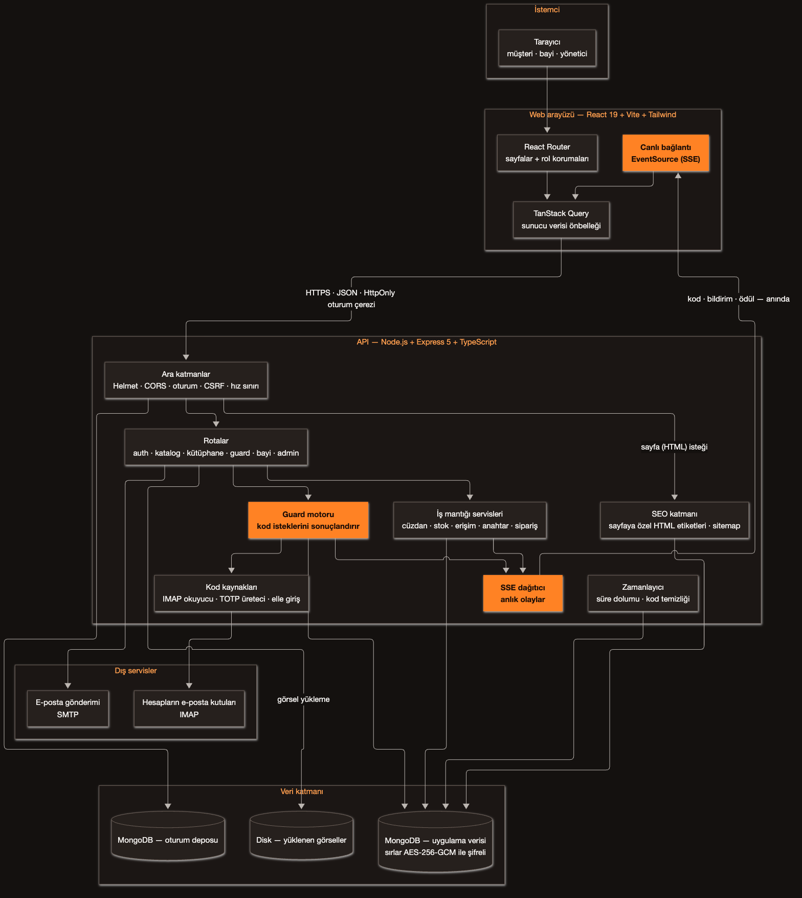

Sistem üç parçadan oluşur: tarayıcıda çalışan **React arayüzü**, **Express API** ve **MongoDB**.

- **İstek yolu (düz oklar)** — arayüz API ile JSON üzerinden konuşur; kimlik, JavaScript'in okuyamadığı `HttpOnly` oturum çereziyle taşınır. Her istek önce ara katmanlardan (Helmet, CORS, oturum, CSRF, hız sınırı) geçer, sonra rotalara, oradan iş mantığı servislerine ulaşır.
- **Canlı kod hattı (turuncu kutular)** — Guard motoru kodu kaynağından alır: hesabın posta kutusu (IMAP), doğrulayıcı sırrı (TOTP / Steam Guard) ya da yöneticinin elle girişi. SSE dağıtıcı kodu, tarayıcının açık tuttuğu bağlantıya **iter**; tarayıcı sormaz, sunucu haber verir. Bildirimler ve ödül ilerlemesi de aynı hattan gelir.
- **Arka plan işleri** — zamanlayıcı süresi dolan erişimleri kapatır, gösterim süresi biten kodları siler.
- **SEO katmanı** — sayfa (HTML) isteklerinde kabuğa o adrese özel başlık, açıklama ve paylaşım etiketlerini yazar.
- **Veri** — hesap giriş bilgileri, IMAP parolaları ve doğrulayıcı sırları veritabanında AES-256-GCM ile şifreli durur. Oturumlar ayrı bir koleksiyonda, yüklenen ürün görselleri diskte tutulur.

### 2. Anahtardan kütüphaneye

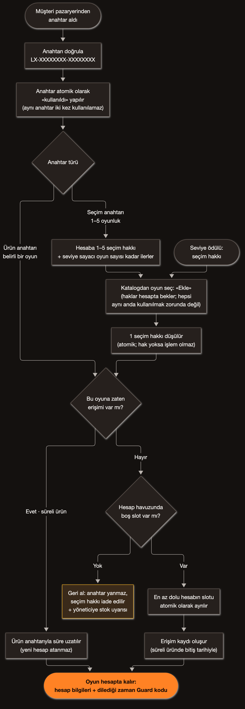

Pazaryerinden alınan anahtarın oyunlara dönüşmesi.

1. **Anahtar bir kez kullanılır.** Anahtar tek bir veritabanı işlemiyle “kullanıldı” yapılır; aynı anahtarı aynı anda sekiz kişi dense yalnızca biri alır.
2. **Anahtar türü.** *Seçim anahtarı* hesaba 1–5 seçim hakkı tanımlar ve seviye sayacını oyun sayısı kadar ilerletir. *Ürün anahtarı* doğrudan belirli bir oyunu açar.
3. **Oyun seçme.** Müşteri katalogda her oyunun altındaki **“Ekle”** düğmesiyle seçer; her seçim onay ister, çünkü geri alınamaz. Haklar hesapta bekler: bugün iki oyun, gelecek hafta üç oyun seçilebilir. Seviye ödülü olarak kazanılan haklar da aynı yoldan kullanılır.
4. **Bir hak, bir oyun.** Hak koşullu ve atomik olarak düşülür; hakkı kalmayan müşteri ekleyemez, aynı oyun ikinci kez eklenemez.
5. **Slot ayırma.** Ürünün hesap havuzundan **en az dolu hesabın** bir slotu ayrılır. Ayırma da atomiktir: iki müşteri son slota aynı anda uzanırsa biri alır, diğeri “stokta yok” yanıtını görür.
6. **Slot yoksa geri alma (sarı kutu).** İşlem bütünüyle geri sarılır: anahtar yanmaz, seçim hakkı iade edilir, yöneticiye stok uyarısı gider.
7. **Sonuç (turuncu kutu).** Oyun **hesapta kalır**; hesap bilgileri ve Guard kodu, müşteri ne zaman isterse erişim panelinde.

Stok bu modelden hesaplanır: **boş slot − henüz doğrulanmamış ürün anahtarı**. Seçim anahtarları belirli bir oyuna bağlı olmadığı için stok ayırmaz; müşteri seçim yaparken stokta olmayan oyunu ekleyemez ve hakkı durur. Site içi satış açılırsa bu akışa üçüncü bir giriş eklenir: bakiyeyle satın alma.

### 3. Guard kodu, adım adım

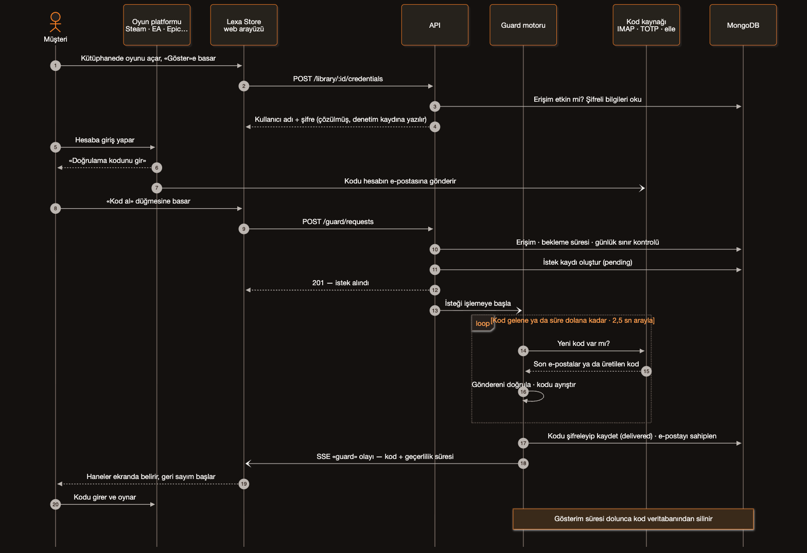

Müşterinin “Kod al”a basmasından kodun ekranda belirmesine kadar olan her şey. Görseldeki numaralar aşağıdaki adımlarla eşleşir.

- **1–4 · Hesap bilgileri.** Müşteri kütüphanesinde “Göster”e basar. API erişimin etkin olduğunu doğrular, şifreli bilgileri çözer ve görüntülemeyi denetim kaydına yazar.
- **5–7 · Platform kodu ister.** Müşteri oyuna giriş yapar; platform doğrulama kodunu hesabın e-postasına gönderir. Bu kısım Lexa Store'un dışında olur.
- **8–13 · İstek açılır.** “Kod al” ile API üç şeyi denetler: erişim etkin mi, bekleme süresi doldu mu (varsayılan 30 sn), günlük sınır aşıldı mı (varsayılan 15). Geçerse isteği `pending` olarak kaydeder ve Guard motoruna devreder.
- **14–16 · Yoklama döngüsü.** Motor kod kaynağını 2,5 saniyede bir yoklar. E-posta kaynağında göndereni platformun bilinen alan adlarıyla doğrular, koda benzeyen adayları bağlamına göre puanlar ve kodu ayrıştırır.
- **17–20 · Teslim.** Kod şifrelenerek kaydedilir, e-posta bu isteğe **sahiplendirilir** (aynı e-posta ikinci bir müşteriye verilemez) ve kod SSE ile müşterinin ekranına itilir. Haneler belirir, geri sayım başlar.
- **Not.** Gösterim süresi (varsayılan 120 sn) dolunca kod veritabanından silinir.

### 4. Kod isteğinin yaşam döngüsü

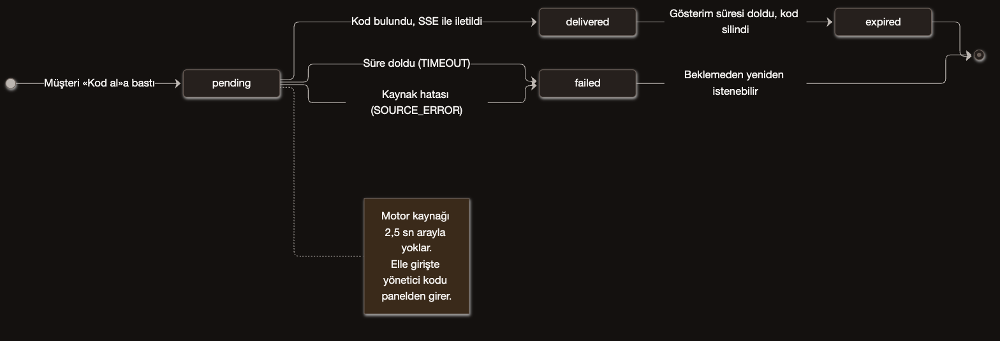

Her kod isteği dört durumdan birindedir:

| Durum | Anlamı | Sonraki adım |
| --- | --- | --- |
| `pending` | İstek alındı, motor kaynağı yokluyor | Kod bulunursa `delivered`, bulunamazsa `failed` |
| `delivered` | Kod müşterinin ekranında, geri sayım işliyor | Süre dolunca `expired` |
| `expired` | Gösterim süresi bitti, kod silindi | — |
| `failed` | Kod zaman aşımına kadar gelmedi (`TIMEOUT`, varsayılan 90 sn) ya da kaynak hata verdi (`SOURCE_ERROR`) | Müşteri beklemeden yeniden isteyebilir |

Sunucu yeniden başlarsa yarım kalan `pending` istekler motor tarafından devralınır; “elle giriş” kaynaklı hesaplarda kodu yönetici panelden girer ve istek aynı yoldan `delivered` olur.

### 5. Paylaşım tespiti

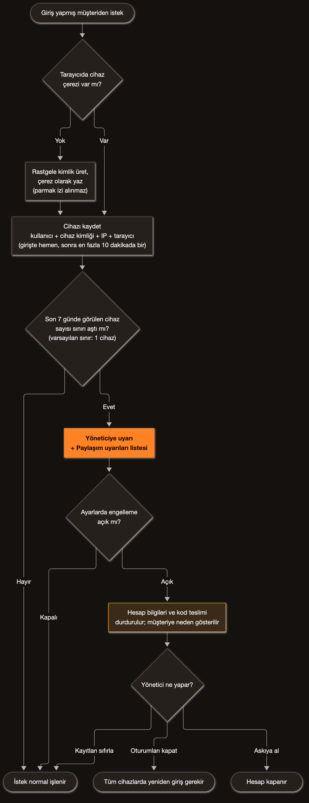

Bir müşteri hesabının birden çok kişi tarafından kullanıldığını fark etmenin yolu.

1. **Cihaz kimliği.** Tarayıcıya rastgele bir kimlik çerez olarak yazılır. Donanım parmak izi alınmaz.
2. **Kayıt.** Cihaz giriş anında, sonrasında en fazla 10 dakikada bir kaydedilir: kullanıcı, cihaz kimliği, IP ve tarayıcı.
3. **Sayım.** Son 7 günde görülen cihaz sayısı sınırla karşılaştırılır. Varsayılan sınır **1 cihazdır**.
4. **Uyarı (turuncu kutu).** Sınır aşılırsa yöneticiye bildirim gider ve hesap *Paylaşım uyarıları* listesine düşer.
5. **Engelleme (sarı kutu) isteğe bağlıdır.** Ayarlardan açılırsa sınırı aşan hesapta hesap bilgileri ve kod teslimi durur, müşteriye nedeni gösterilir. Varsayılan olarak kapalıdır; sistem yalnızca uyarır.
6. **Yöneticinin önlemleri.** Cihaz kayıtlarını sıfırlamak (müşteri haklıysa), tüm oturumları kapatmak ya da hesabı askıya almak.

### 6. Frontend mimarisi

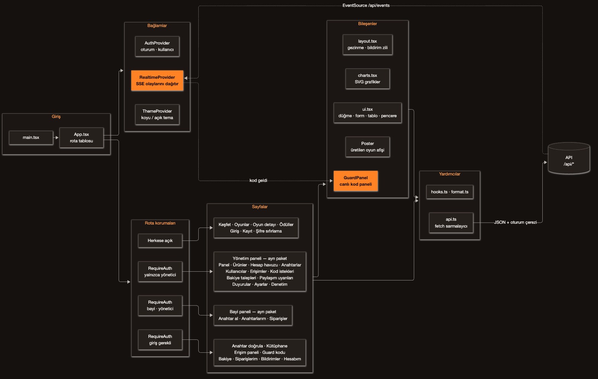

- **Bağlamlar** uygulamanın tamamına üç şey sağlar: oturumdaki kullanıcı, tema ve canlı bağlantı.
- **Rota korumaları** dört kademedir: herkese açık, giriş gerekli, bayi + yönetici, yalnızca yönetici. Bu yalnızca arayüz düzenidir; asıl yetki denetimi sunucudadır.
- **Bayi ve yönetim panelleri ayrı paketlerdir**; müşteri bu kodu hiç indirmez.
- **Canlı bağlantının yolu (kesikli oklar)** — sunucudan gelen olay `RealtimeProvider`'a ulaşır, o da ilgili bileşene dağıtır. Kod geldiğinde `GuardPanel` haneleri sayfa yenilenmeden gösterir.
- Sunucuyla bütün konuşma tek bir sarmalayıcıdan (`api.ts`) geçer; hata biçimi ve oturum çerezi tek yerde ele alınır.

### 7. Backend mimarisi

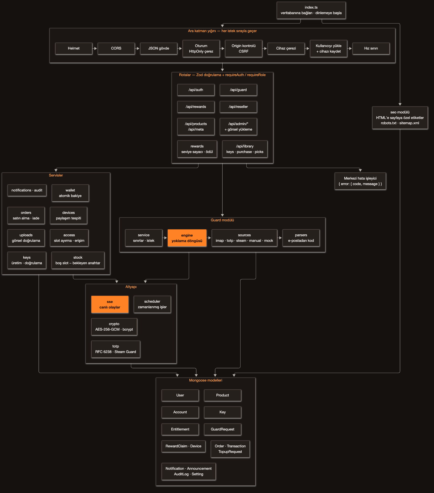

Bir istek yukarıdan aşağıya şu katmanlardan geçer:

1. **Ara katman yığını** — güvenlik başlıkları, CORS, gövde ayrıştırma, oturum, `Origin` denetimi (CSRF), cihaz çerezi, kullanıcıyı yükleme ve hız sınırı. Sıra önemlidir: kimliği belli olmayan istek rotaya ulaşmaz.
2. **Rotalar** — her uç nokta girdisini Zod şemasıyla doğrular ve gereken rolü denetler. Hatalar tek bir işleyiciden, tek biçimde döner.
3. **Servisler** — iş kuralları burada yaşar: anahtar üretimi ve doğrulaması, slot ayırma, stok hesabı, ödüller, paylaşım tespiti, görsel doğrulama. Rotalar ince kalır.
4. **Guard modülü** — dört parçalı bir hat: sınırları denetleyen servis → yoklama döngüsünü çalıştıran motor → takılabilir kod kaynakları → e-postadan kod ayrıştırıcı.
5. **Altyapı** — şifreleme, TOTP / Steam Guard üretimi, canlı olay dağıtımı ve zamanlanmış işler.
6. **Modeller** — MongoDB'ye yalnızca Mongoose modelleri üzerinden erişilir; şifreli alanlar API yanıtlarından model katmanında temizlenir.

### 8. Veritabanı şeması

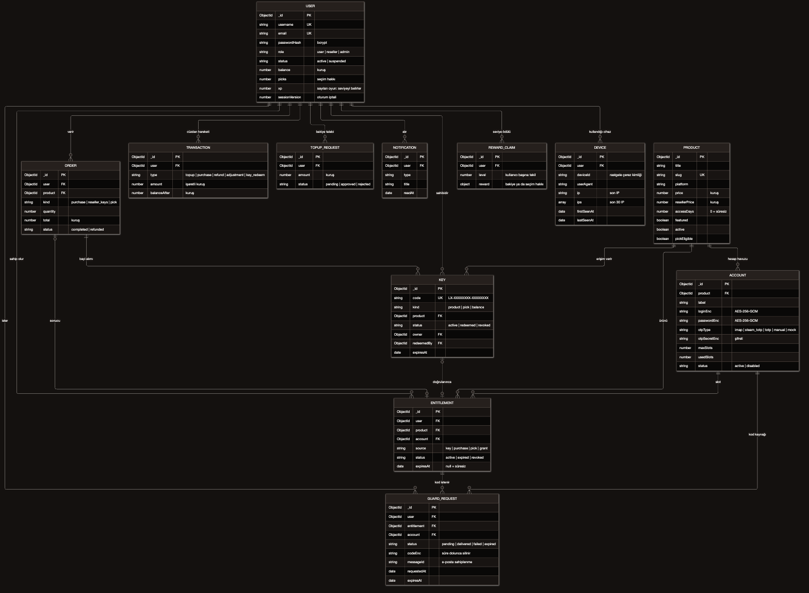

Şemanın omurgası dört kayıttır:

- **Ürün → Hesap (havuz).** Bir ürünün birden çok hesabı, her hesabın birden çok slotu vardır.
- **Anahtar.** Bir ürüne erişim verir; doğrulandığında tek bir erişim kaydına bağlanır.
- **Erişim (Entitlement).** “Bu kullanıcı, bu ürünü, bu hesabın bir slotuyla kullanıyor” bilgisidir. Kütüphane, hesap bilgileri ve kod isteği yetkisi bu kayıttan türer.
- **Kod isteği.** Bir erişime ve onun hesabına bağlıdır; kodun hangi kaynaktan, ne zaman geldiğini taşır.

Çevresinde cüzdan hareketleri ve siparişler (bayi kanalı ve site içi satış için), bildirimler, ödül kayıtları ve cihaz kayıtları durur. Tutarlılığı üç benzersiz indeks korur: bir kullanıcının aynı ürüne tek **etkin** erişimi olabilir, bir e-posta tek bir kod isteğine verilebilir, bir seviye ödülü bir kez alınabilir.

## Özellikler

### Müşteri

- **Anahtar doğrulama** — `LX-XXXXXXXX-XXXXXXXX` biçiminde seçim anahtarı ya da ürün anahtarı. Yazarken biçimlenir, panodan yapıştırılır.
- **Oyun seçme** — seçim hakkı olan müşteride katalog seçim moduna geçer: üstte kalan hak sayısı, her oyunun altında “Ekle” düğmesi, hesaptaki oyunlarda “Kütüphanende” işareti. Kalan hak üst çubukta da görünür.
- **Fiyatsız katalog** — oyunlarda fiyat yazmaz; hakkı olmayan müşteri pazaryerine ve anahtar doğrulamaya yönlendirilir.
- **Oyunlar hesapta kalır** — eklenen oyunlar kütüphanede, **Anahtar doğrula** sayfasındaki “Hesabındaki oyunlar” listesinde ve **Hesabım** sayfasında durur; her birinin yanında “Kod al” ve “Hesap bilgileri” kısayolu vardır.
- **Kütüphane ve erişim paneli** — hesap bilgileri ile doğrulama kodu **aynı ekranda**. Şifreler varsayılan olarak gizlidir; her görüntüleme kayda geçer.
- **Canlı Guard kodu** — kod geldiği an ekrana düşer (SSE), geri sayımla birlikte. Bağlantı koparsa kendiliğinden yedek sorgu moduna geçer.
- **Süreli erişim** — abonelik türü ürünlerde bitime 3 gün kala hatırlatma; aynı ürünün anahtarı doğrulanınca süre uzar.
- **Ödüller ve seviyeler** — doğrulanan anahtarın getirdiği her oyun seviye sayacını ilerletir ve **sayaç her seviyede sıfırdan başlar**: 5 oyun → 1 seçim hakkı, sonra 10 oyun → 3, 15 → 5, 20 → 6, 25 → 8. Seviyeyi tamamlarken artan oyunlar sonraki seviyeye sayılır. İlerleme sayfa yenilemeden güncellenir.
- **Siparişlerim** — doğrulanan anahtarlar (yalnızca son dört hanesi görünür; müşteri bununla pazaryerindeki siparişini eşleştirir) ve hesaba eklenen her oyun: tarih, nasıl eklendiği, bitiş ve durum.
- Bildirim merkezi, duyuru şeridi, profil simgesi, koyu/açık tema, tamamen duyarlı (mobil) arayüz.

### Bayi

- İsteğe bağlı kanal: müşteriler görmez; yalnızca **bayi** rolü verdiğin kullanıcılara (ve yöneticiye) açıktır. Bayi, bakiyesini havale/EFT bildirimiyle yükler; yönetici onaylar ya da bakiyeyi elle tanımlar.
- İndirimli bayi fiyatından **toplu anahtar alımı**; anahtarlar alım anında üretilir.
- Anahtar listesi (bekleyen / doğrulanan), tek tıkla kopyalama ve `.txt` indirme, sipariş geçmişi.

### Yönetici

- **Gösterge paneli** — son 30 günde doğrulanan anahtar, etkin erişim, kod teslim oranı, slot doluluğu; kod istekleri ve günlük doğrulanan anahtar grafikleri (klavyeyle gezilebilir, tablo görünümlü). Site içi satış açılırsa ciro göstergelerine döner.
- **Ürünler** — erişim süresi, kullanım kuralları, seçim anahtarıyla eklenip eklenemeyeceği ve isteğe bağlı pazaryeri bağlantısı. Fiyat alanları isteğe bağlıdır ve yalnızca bayi paneli ile site içi satışta kullanılır. Kapak görseli **dosya olarak yüklenir** (tarayıcıda küçültülüp WebP'ye çevrilir) ya da adresle eklenir; görsel yoksa ürün adından **otomatik afiş** üretilir.
- **Hesap havuzu** — her hesap için slot sayısı ve kod kaynağı; **“kaynağı test et”** düğmesi satıştan önce ayarları doğrular.
- **Anahtarlar** — **1–5 oyunluk seçim anahtarlarını** (ya da belirli bir oyunun ürün anahtarını) toplu üret, kopyala ya da `.txt` olarak indir, süz, iptal et.
- **Kullanıcılar** — rol ve durum, seçim hakkı, elle erişim tanımlama, (bayiler için) bakiye düzeltme.
- **Kod istekleri** — tüm isteklerin kaydı; “elle giriş” kaynaklı hesaplarda kodu panelden gir, müşteri anında görsün.
- **Bakiye talepleri** — bayilerin havale/EFT bildirimlerini onayla ya da reddet.
- **Paylaşım uyarıları** — bir müşteri hesabı 7 günde belirlediğin sayıdan (varsayılan **1 cihaz**) fazla cihazda kullanılırsa uyarı; cihaz listesini incele, oturumları kapat, kayıtları sıfırla ya da hesabı askıya al. İstersen sınır aşılınca hesap bilgileri ve kod teslimi kendiliğinden dursun.
- Duyurular, toplu bildirim, sistem ayarları (bekleme süresi, günlük sınır, zaman aşımı…) ve **denetim kaydı**.

### Arama motorları ve paylaşım önizlemeleri

- Her sayfa adresi için sunucu, HTML'e o sayfaya özel **başlık, açıklama, kanonik adres ve Open Graph / Twitter etiketleri** yazar; bağlantı WhatsApp, Discord ya da Telegram'da paylaşıldığında doğru önizleme çıkar.
- Ürün sayfalarında **yapılandırılmış veri** (schema.org `Product`); fiyat ve teklif bilgisi yalnızca site içi satış açıkken yayınlanır. Ana sayfada site araması verisi.
- `sitemap.xml` (satıştaki tüm ürünler) ve `robots.txt` (hesap, bayi ve yönetim alanları kapalı); olmayan ürün ve sayfalar gerçek **404** döner.

### Öne çıkan tasarım kararları

| Konu | Karar | Kazanım |
| --- | --- | --- |
| Satış | Pazaryerinde satılır, sitede teslim edilir; site içi satış tek anahtarla açılır | Ödeme altyapısı, iade ve fatura yükü yok; sitenin işi anahtarı doğrulamak ve kodu yetiştirmek |
| Ürün modeli | Oyunların fiyatı yok; 1–5 oyunluk seçim anahtarı satılır, müşteri oyunlarını kendi seçer | Tek ilanla bütün katalog satılır; fiyat yalnızca pazaryerinde durur, sitede ve API yanıtında yer almaz |
| Kod teslimi | Sunucu iter (SSE), bağlantı koparsa otomatik yedek sorgu | Kod geldiği saniye ekranda; boşa sorgu trafiği yok |
| Kod kaynağı | Takılabilir kaynaklar: IMAP, Steam doğrulayıcı, TOTP, elle giriş, demo | Her hesap kendi yöntemiyle çalışır; yeni kaynak eklemek kolay |
| Hesap modeli | **Hesap havuzu**: ürün başına çok hesap, hesap başına çok slot | Müşteriler en az dolu hesaba dengeli dağıtılır |
| Paylaşımlı hesapta çakışma | E-posta **sahiplenme**: bir e-posta yalnızca bir isteğe atanır (benzersiz indeks) | Aynı kod iki müşteriye verilmez |
| Sırların saklanması | AES-256-GCM ile şifreli; kodlar süre dolunca silinir | Veritabanı sızsa bile giriş bilgileri açığa çıkmaz |
| Para ve stok | **Atomik** koşullu güncellemeler + başarısızlıkta geri alma | Eşzamanlı isteklerde çift harcama / çift kullanım olmaz |
| Stok | Boş slot − bekleyen ürün anahtarı; seçimde stok anlık denetlenir | Stokta olmayan oyun eklenemez, hak yanmaz |
| Paylaşım tespiti | Tarayıcıya yazılan rastgele cihaz kimliği (donanım parmak izi yok); varsayılan sınır 1 cihaz | Gizliliğe daha az müdahale; varsayılan olarak yalnızca uyarır, engellemez |
| Görsel yükleme | Tür, dosyanın ilk baytlarından doğrulanır; ad sunucuda üretilir; SVG kabul edilmez | Zararlı dosya ve dizin atlama riski yok |
| Arama görünürlüğü | HTML kabuğuna sayfaya özel etiket ekleme (tam SSR değil) | Küçük bir katmanla doğru önizleme ve yapılandırılmış veri |
| Kod tabanı | Uçtan uca TypeScript, 120 arka uç testi + tarayıcı duman testi | Değişiklikler güvenle yapılır |

## Ekran görüntüleri

| | |
| --- | --- |
| 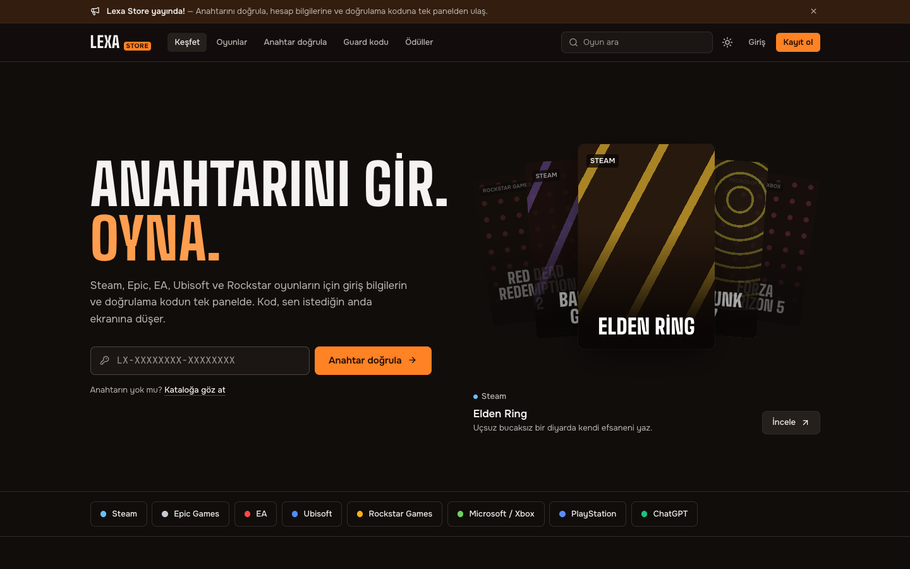 **Ana sayfa** — anahtar girişi ve öne çıkan oyunlar | 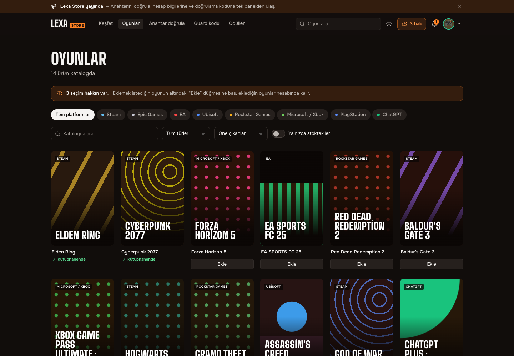 **Katalog** — seçim modu: kalan hak, “Ekle” düğmeleri, fiyat yok |
| 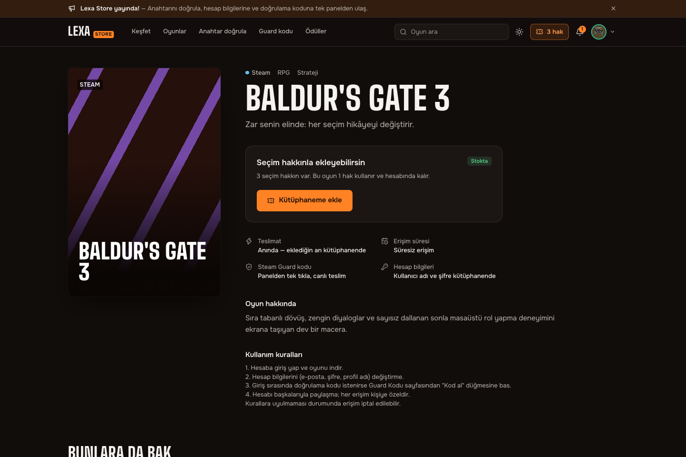 **Ürün sayfası** — seçim hakkıyla “Kütüphaneme ekle” | 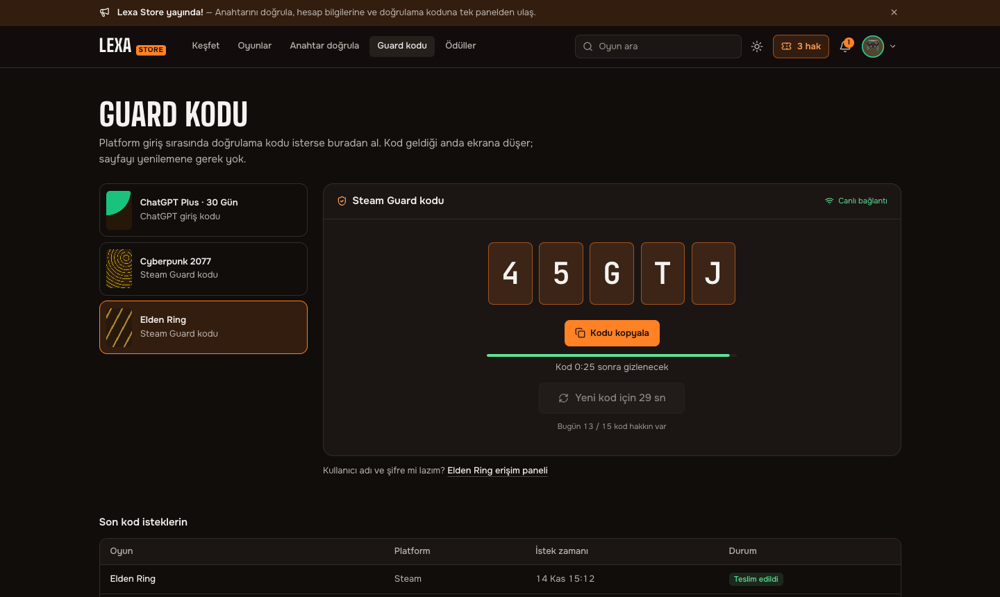 **Guard kodu** — canlı teslim ve geri sayım |
| 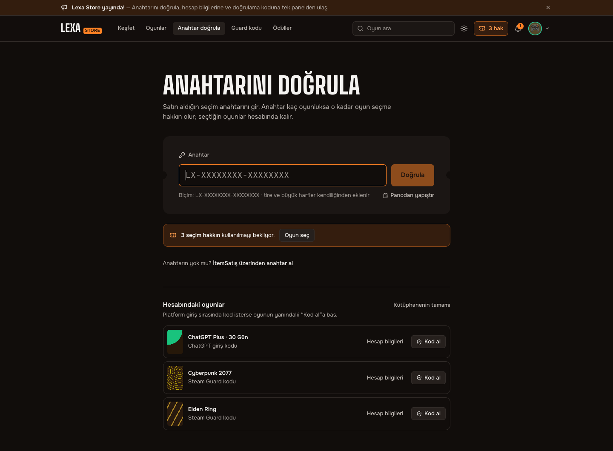 **Anahtar doğrulama** — altında hesaptaki oyunlar ve “Kod al” | 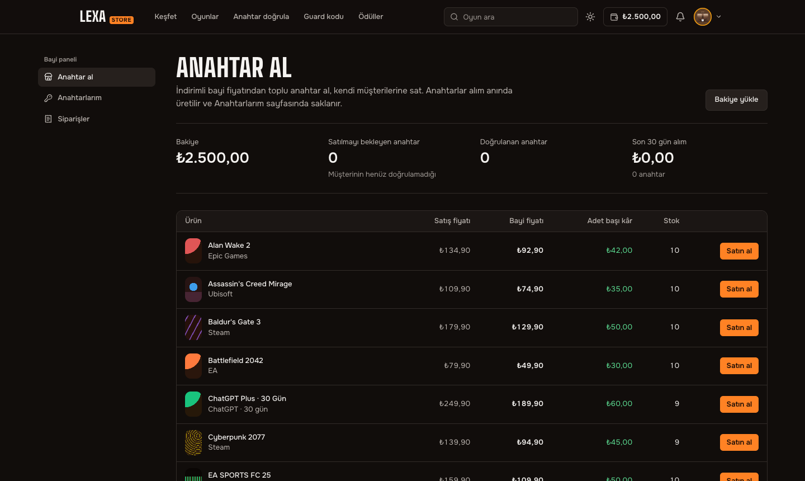 **Bayi paneli** — isteğe bağlı toplu anahtar alımı |
| 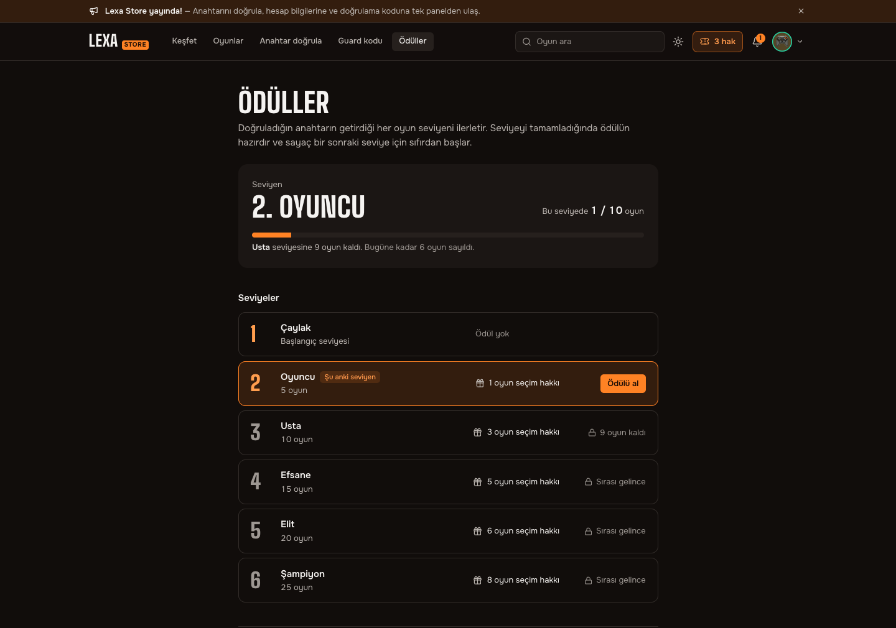 **Ödüller** — seviye, bu seviyedeki oyun sayacı ve alınmayı bekleyen ödül | 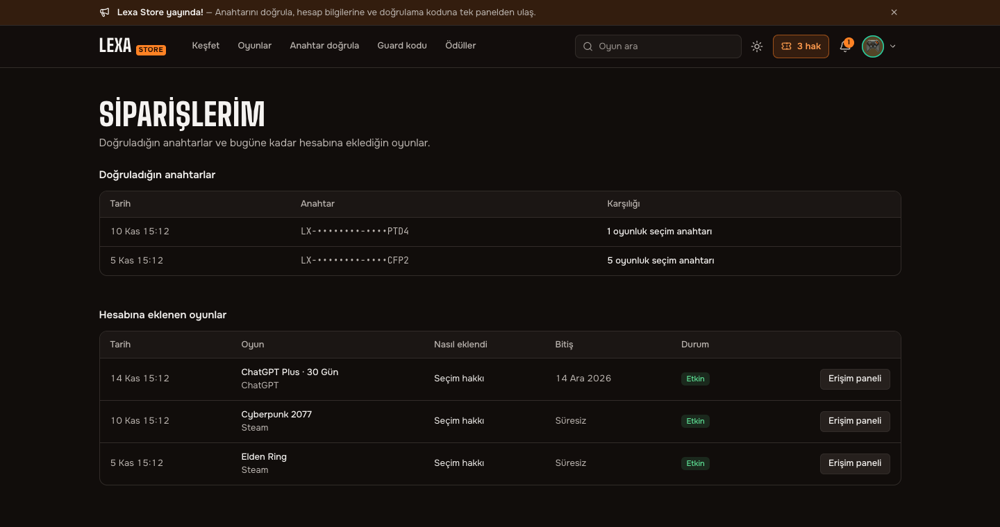 **Siparişlerim** — doğrulanan anahtarlar ve eklenen oyunlar |
| 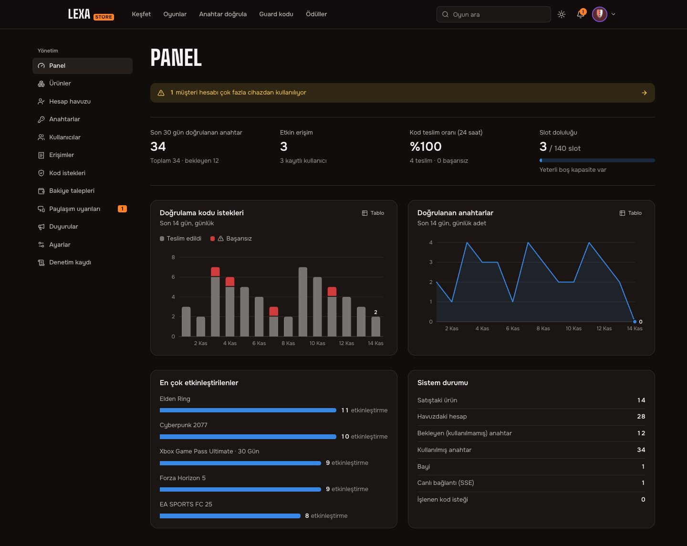 **Yönetim paneli** — özet ve grafikler | 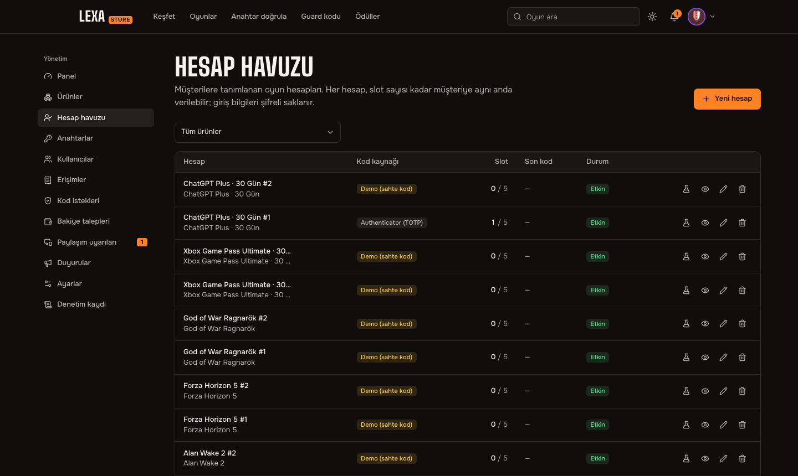 **Hesap havuzu** — slotlar ve kod kaynakları |
| 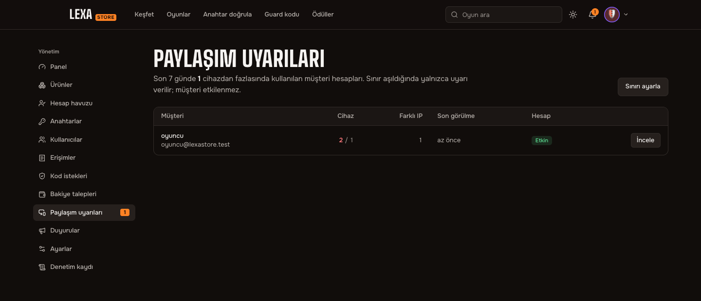 **Paylaşım uyarıları** — cihaz sınırını aşan hesaplar | 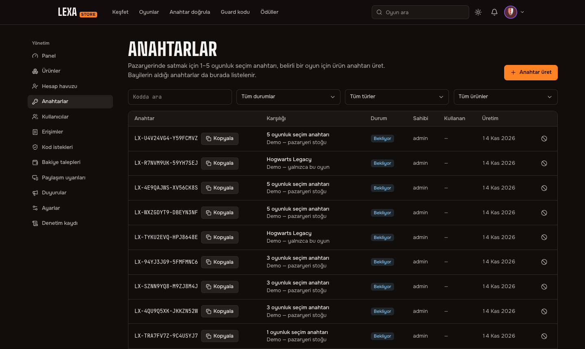 **Anahtarlar** — 1–5 oyunluk seçim anahtarı üretimi |

> Katalogdaki kapaklar ürün adından ve vurgu renginden **otomatik üretilen afişlerdir**; telifli görsel içermez. Kendi kapaklarını ürün formundan ekleyebilirsin (yalnızca kullanım hakkına sahip olduğun görselleri kullan).

## Doğrulama kodu kaynakları

Her hesabın kod kaynağı **Yönetim → Hesap havuzu → hesabı düzenle** ekranından seçilir. Kaydettikten sonra satırdaki deney tüpü simgesiyle **kaynağı test et**.

| Kaynak | Ne zaman? | Gereken bilgi |
| --- | --- | --- |
| **E-posta (IMAP)** | Platform kodu hesabın e-postasına gönderiyorsa | IMAP sunucusu, kullanıcı adı, **uygulama şifresi** |
| **Steam doğrulayıcı** | Hesapta Steam mobil doğrulayıcı açıksa | `maFile` içindeki `shared_secret` (base64) |
| **Authenticator (TOTP)** | Hesap Google Authenticator vb. ile korunuyorsa | Kurulum anahtarı (base32) |
| **Elle giriş** | Kod otomatik alınamıyorsa | — (yönetici kodu panelden girer) |
| **Demo** | Yalnızca deneme | — (canlı ortamda kapalıdır) |

**IMAP ipuçları**

- Gmail normal şifreyi kabul etmez; hesap ayarlarından **uygulama şifresi** oluştur. Sunucu `imap.gmail.com`, port `993`, SSL açık.
- Giriş yalnızca kullanıcı adı + şifreyle yapılır; **OAuth2 desteklenmez**. Şifreyle IMAP girişini kapatmış sağlayıcılarda (ör. kişisel Outlook/Hotmail hesapları) kod e-postalarını, şifreyle IMAP'e izin veren bir kutuya yönlendir.
- Birden çok hesabın kodu **aynı posta kutusuna** düşüyorsa *alıcı süzgeci* (ör. `hesap3@`) ya da *gövde süzgeci* (ör. Steam hesap adı) ile doğru e-postayı ayır.
- Gönderen adresi platformun bilinen alan adlarıyla (ör. `steampowered.com`) alan adı sınırında eşleştirilir; benzer görünen sahte alan adları elenir. Yönlendirme kullanıyorsan *gönderen süzgecini* kendin belirle.
- Yeni bir platform eklemek için `server/src/config/platforms.ts` dosyasına bir kayıt eklemek yeterli; ayrıştırıcı kod biçimine göre kendiliğinden çalışır.

## Güvenlik

- **Sırlar şifreli** — hesap giriş bilgileri, IMAP parolaları ve doğrulayıcı sırları AES-256-GCM ile saklanır; API yanıtlarından her derinlikte temizlenir. Teslim edilen kod da şifreli tutulur ve süre dolunca silinir.
- **Oturum** — `HttpOnly`, `SameSite=Lax`, canlıda `Secure` çerez; girişte oturum kimliği yenilenir; şifre değişince diğer cihazlardaki oturumlar düşer; askıya alınan kullanıcının açık oturumu kapanır.
- **CSRF** — durum değiştiren isteklerde `Origin` denetimi + `SameSite` çerez.
- **Kaba kuvvet** — başarısız giriş ve hatalı anahtar denemeleri hız sınırına tabidir; var olmayan kullanıcıda da gerçek bir şifre karşılaştırması yapılır ve aynı mesaj döner.
- **Yetki** — rol tabanlı erişim (oyuncu / bayi / yönetici) sunucuda uygulanır; müşteri yalnızca kendi erişiminin bilgisini ve kodunu görebilir.
- **Doğrulama** — tüm girdiler Zod şemalarıyla denetlenir; hatalar tek biçimde ve Türkçe döner. Bağlantı ve görsel alanları yalnızca `http(s)` adreslerini kabul eder (`javascript:` gibi şemalar reddedilir).
- **Dosya yükleme** — yalnızca yönetici; PNG / JPEG / WebP, en fazla 2 MB. Tür, içeriğin ilk baytlarından doğrulanır, dosya adı sunucuda üretilir, SVG kabul edilmez.
- **Paylaşım tespiti** — cihazlar rastgele bir çerez kimliğiyle tanınır; donanım parmak izi alınmaz. Cihaz, giriş anında kaydedilir. Yönetici panelinde kimliğin yalnızca kısa bir izi gösterilir.
- **Kapalı özellik sunucuda da kapalıdır** — site içi satış kapalıyken satın alma, müşteri bakiye talebi ve bakiye kodu üretimi API'de reddedilir; oyun fiyatları müşteriye giden yanıtlara hiç konmaz.
- **İz** — hesap bilgisi görüntüleme, kod isteme, anahtar doğrulama ve yönetim işlemleri IP adresiyle denetim kaydına yazılır.
- **Başlıklar** — Helmet; arayüz API'den sunulduğunda sıkı bir içerik güvenlik politikası (CSP) uygulanır.
- Canlı ortamda `SESSION_SECRET` ve `ENCRYPTION_KEY` verilmeden sunucu **başlamaz**; demo verisi ve demo kod kaynağı devre dışıdır.

> `ENCRYPTION_KEY` kaybolursa şifreli hesap bilgileri çözülemez. Anahtarı yedekle ve veritabanı yedeğinden ayrı bir yerde sakla.

## Testler

Sistem 120 arka uç testi ve gerçek tarayıcıda çalışan bir duman testiyle doğrulanır. Arka uç testlerinde her dosya kendi bellek içi MongoDB'sinde çalışır:

- **Birim** — TOTP (RFC 6238 test vektörleri), Steam Guard kodu (bağımsız `steam-totp` kütüphanesiyle çapraz doğrulanmış vektörler), şifreleme, anahtar biçimi, e-posta ayrıştırıcı ve gönderen eşleştirme.
- **Mağaza** — kayıt/giriş/şifre sıfırlama, roller, CSRF, anahtar doğrulama, slot dağıtımı, süre uzatma ve dolumu, cüzdan, satın alma, bayi alımı, yönetim işlemleri; **eşzamanlılık**: aynı anahtarı 8 kişi aynı anda dener → yalnızca biri alır; bakiyeden fazlası harcanamaz.
- **Pazaryeri modeli ve yeni özellikler** — fiyatın müşteriye hiç gönderilmemesi (liste, ürün sayfası, sıralama, yapılandırılmış veri); 1–5 oyunluk seçim anahtarı: üretim sınırları, hak kadar oyun ekleme, hak bitince ve aynı oyunda ret; doğrulanan anahtarların maskeli listesi; site içi satış kapalıyken satın alma, bakiye talebi ve bakiye kodu üretiminin reddi; kısmi güncellemelerin gönderilmeyen alanlara dokunmaması; seviye tablosu ve her seviyede sıfırlanan sayaç (artan oyunların devri dahil), ödül alma (aynı ödül eşzamanlı 6 istekle bir kez verilir), paylaşım tespiti (sınır, engelleme, sıfırlama, pencere dışı cihazlar), görsel yükleme (sahte içerik, SVG, boyut sınırı, dizin atlama), bağlantı alanlarında `javascript:` reddi, SEO etiketleri ve bunların HTML/betik kaçışına karşı güvenliği.
- **Guard** — bekleme süresi ve günlük sınır, TOTP/Steam kaynakları, IMAP kaynağı (sahte posta kutusuyla): geç gelen e-posta, sahte gönderen, ortak kutu süzgeçleri, **iki müşterinin aynı anda kod istemesi**, zaman aşımı, sunucu yeniden başlayınca yarım kalan isteklerin devralınması.

**Arayüz duman testi** (`e2e/smoke.mjs`) bilgisayardaki Chrome'u kullanarak formları gerçekten doldurur: yeni müşteri kaydı, 2 oyunluk seçim anahtarının tuş tuş yazılması, katalogda ve API yanıtında fiyat **bulunmadığı**, “Ekle” ile iki oyunun seçilmesi ve hak bitince düğmelerin kalkması, seviye sayacının ilerlemesi (2 / 5 oyun), doğrulama sayfasındaki oyun listesinden Guard kodunun canlı gelişi, hesap bilgileri, geçmişte gizlenmiş anahtar, kullanılmış anahtarın reddi, bayinin toplu alımı ve çıkış.

## Bilinen sınırlar ve yol haritası

- **IMAP gerçek posta kutusunda henüz doğrulanmadı.** E-posta ayrıştırıcı, platform e-postalarının yapısını taklit eden sentetik örneklerle test edildi. İlk gerçek hesabı eklerken “kaynağı test et” ile doğrula; bir platformun e-posta biçimi tutmazsa `parsers.ts` içindeki kuralları uyarlamak gerekir.
- **Sitede ödeme yok — bilerek.** Satış pazaryerinde yapılır. Site içi satışı açarsan bakiye yalnızca havale/EFT bildirimi + yönetici onayıyla ya da bakiye koduyla yüklenir; sanal POS (iyzico, PayTR, Shopier…) entegrasyonu yoktur.
- **Pazaryeriyle otomatik bağlantı yok.** Sipariş gelince anahtarı pazaryerinde sen teslim edersin; pazaryerin otomatik teslimatı destekliyorsa üretilen anahtarları `.txt` olarak indirip oraya önceden yükleyebilirsin. Sipariş bildirimini dinleyip anahtarı kendiliğinden gönderen bir entegrasyon eklenmedi.
- **Geliştirme modunda çok sekme.** Vite geliştirme sunucusu HTTP/1.1 kullanır; aynı tarayıcıda 6'dan fazla sekme açarsan canlı bağlantılar tarayıcının bağlantı sınırını doldurur. Canlıda HTTP/2 ile bu sorun yaşanmaz.
- **Arama görünürlüğü tam SSR değil.** Başlık, açıklama, paylaşım etiketleri ve yapılandırılmış veri sunucuda yazılır; sayfa gövdesi yine tarayıcıda çizilir. Görseli olmayan ürünlerin paylaşım önizlemesinde genel mağaza görseli kullanılır.
- **Paylaşım tespitinde yanlış alarm olabilir.** Gizli sekme, çerez temizliği ve ikinci bir tarayıcı yeni cihaz sayılır. Sınır 1 cihazken telefonundan da giren dürüst bir müşteri de uyarı listesine düşer; bu yüzden engelleme varsayılan olarak kapalıdır. Açmadan önce birkaç gün yalnızca uyarıları izle.
- **Seviye tablosu (oyun sayıları ve ödüller) ve anahtar boyutu sınırı kodda durur** (`server/src/config/levels.ts`); yönetim panelinden düzenlenemez.
- **Seçim anahtarı stok ayırmaz.** Anahtar belirli bir oyuna bağlı değildir; çok anahtar satıp az hesap eklersen müşteri istediği oyunu stokta bulamayabilir (hakkı yanmaz, başka oyun seçer ya da bekler). Hesap havuzunu sattığın anahtar sayısına göre büyüt.
- **Bayi paneli yalnızca ürün anahtarı satar**; bayiler seçim anahtarı alamaz.
- **Yüklenip kaydedilmeyen görseller diskte kalır** (ürün formu görsel yükledikten sonra iptal edilirse); otomatik temizlik yok.
- **Tek süreç.** Canlı bağlantılar ve Guard motoru süreç belleğinde yaşar. Birden çok API kopyası çalıştırmak için SSE dağıtımını ve motor kuyruğunu Redis'e taşımak gerekir (arayüzler buna göre ayrıldı).
- **Paylaşımlı hesapta eşzamanlı giriş.** İki müşteri aynı hesaba aynı saniyelerde giriş denerse hangi e-postanın kime ait olduğu bilinemez; sistem her e-postayı yalnızca bir müşteriye verir ama eşleşme ters düşebilir. Bu durumda müşteri yeni kod ister.
- IMAP girişi OAuth2 desteklemez (yukarıdaki IMAP ipuçlarına bak).
- Tarayıcı anlık bildirimleri (Web Push), robot doğrulaması (CAPTCHA), iki adımlı yönetici girişi ve Docker dosyaları henüz yok.
- Gizlilik politikası ve kullanım koşulları sayfaları **taslak şablondur**; yayına almadan önce hukuki olarak gözden geçirilmelidir.
- Üçüncü taraf platformların kullanım koşulları hesap paylaşımını kısıtlayabilir; hangi ürünleri nasıl sattığın senin sorumluluğundadır.

## Teknolojiler

**Arayüz:** React 19, Vite, TypeScript, Tailwind CSS 4, TanStack Query, React Router, Sonner, Lucide

**API:** Node.js, Express 5, TypeScript, Mongoose (MongoDB), Zod, express-session + connect-mongo, Helmet, express-rate-limit, ImapFlow, Mailparser, Nodemailer, bcryptjs

**Test:** Vitest, Supertest, mongodb-memory-server
